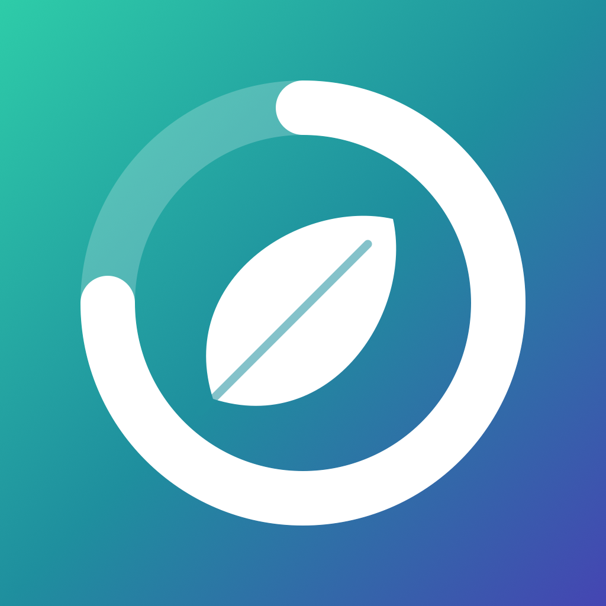
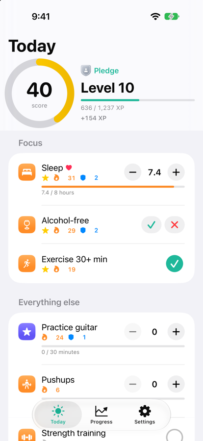
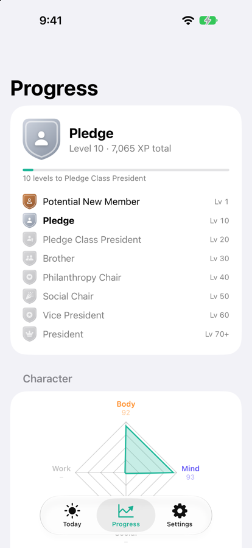
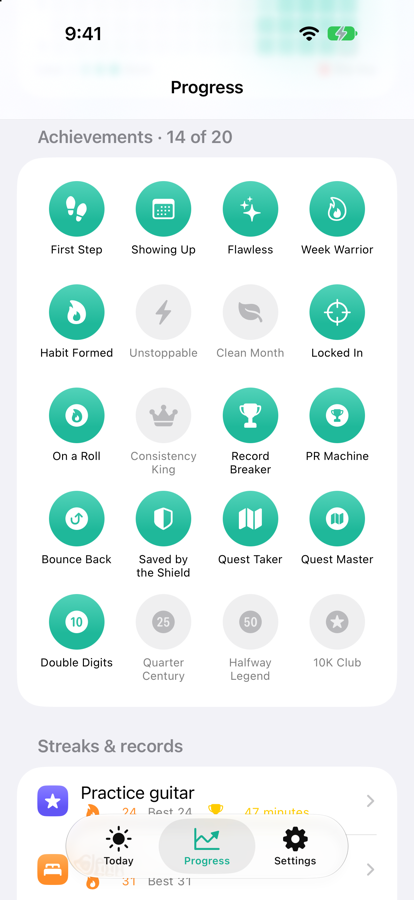
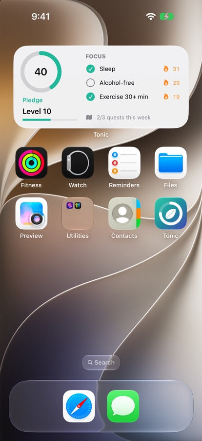

<p align="center">
  
</p>

<h1 align="center">Tonic</h1>

<p align="center"><b>Level up your life, one habit at a time.</b></p>

Tonic is an iOS app that turns your habits into a game. Pick the behaviors you care about,
good ones to build and bad ones to cut, rank them by what matters most, and log your day.
You earn XP, build streaks, set personal records, complete weekly quests and climb through
the ranks.

**Tonic is private.** There are no accounts, no servers and no analytics. Everything stays on
your phone, and you can export all of it as a JSON file whenever you like.

<p align="center">
  
  
  
  
</p>

## Features

- **Four kinds of habits:** yes/no habits, habits to avoid, targets with partial credit (sleep, water, screen time) and "more is better" habits with personal records. Start from a library of 35 or create your own.
- **Your priorities, your score:** rank your habits and pick 2–3 Focus habits. A perfect day is always 100.
- **Compounding rewards:** streaks boost XP up to 2×, Perfect Focus Days, combo weeks, comebacks and PRs all pay bonuses.
- **Real consequences:** slips cost double and cancel that day's streak bonuses, but levels never drop.
- **Ranks every 10 levels** with badges, in a Plant or Frat theme.
- **Weekly quests, 20 achievements, character stats** for Body, Mind, Social and Work, and a weekly recap.
- **Home-screen and Lock Screen widget**, daily reminders and **Apple Health sync** for sleep, steps, exercise, mindful minutes and water.

## How scoring works

Every behavior is one of four types, and each day it gets a quality from 0 to 1:

| Type | Example | How it's scored |
|---|---|---|
| Check | Meditate | Done = 1, not done = 0 |
| Avoid | Alcohol | Clean = 1, slipped = **−2** (slips cost double) |
| Target | Sleep 8h, screen time ≤ 3h | Partial credit toward the target |
| Volume | Study minutes | Credit up to a reference amount, bonus XP beyond it, personal records |

- **Daily Score (−100 to 100):** your behaviors weighted by priority. Rank #1 weighs 2× the last one, and your 2–3 Focus habits get an extra 1.5×. Weights always add up to 1, so a perfect day is 100.
- **XP:** your Daily Score plus compounding bonuses: **+5% per streak day** (up to +100%), **×1.25 Perfect Focus Day**, **combo week** (5 days at 70+), **comeback** and **personal record** bonuses. A slip on any habit cancels every streak bonus for that day, so slipping always costs real XP.
- **Levels:** XP to the next level = `220 × level^0.75`, so each level takes a little longer. **Levels never drop**: a slip can drain XP back to the start of your level, but no further.
- **Streak shields:** earn one every 7-day streak (hold up to 2). A shield covers a missed day automatically. Slips are never shielded.
- **Weekly quests:** three new challenges every Monday, picked from your own habits, each worth bonus XP.
- **Ranks:** every 10 levels, in your choice of theme:

| Levels | Plant | Frat |
|---|---|---|
| 1–9 | Seedling | Potential New Member |
| 10–19 | Sprout | Pledge |
| 20–29 | Sapling | Pledge Class President |
| 30–39 | Bloom | Brother |
| 40–49 | Grove | Philanthropy Chair |
| 50–59 | Evergreen | Social Chair |
| 60–69 | Redwood | Vice President |
| 70+ | Ancient | President |

All of these numbers live in [`Tuning.swift`](TonicKit/Sources/TonicKit/Engine/Tuning.swift). A steady user reaches level 10 in about a month and level 30 in about 7 months.

## Apple Health

Turn on **Settings → Apple Health** to fill in Sleep, Steps, Exercise, Meditate and Hydration
automatically. Tonic only reads Health data, keeps it on your phone, and never overwrites
anything you logged by hand.

## Getting started

You need **Xcode 27 or later**; the app runs on **iOS 18 or later**.

1. Open `Tonic.xcodeproj`.
2. Pick an iPhone simulator and press **Run**.

To run on your own iPhone, copy `Config/Local.xcconfig.example` to `Config/Local.xcconfig`
and add your Apple developer team ID and a bundle ID prefix. See [CONTRIBUTING.md](CONTRIBUTING.md).

Run the engine tests with:

```bash
./scripts/test-engine.sh
```

## Project layout

```
Tonic.xcodeproj      Xcode project for the iOS app
Tonic/               SwiftUI app
  App/               App entry point and settings keys
  Models/            On-device storage (SwiftData)
  Health/            Apple Health sync
  Features/          Onboarding, Today, Progress, Settings
  DesignSystem/      Shared views, rank badges and styling
TonicWidget/         Home-screen and Lock Screen widget
TonicKit/            Swift package: scoring engine, quests, achievements, presets (no UI, fully tested)
Config/              Build settings, entitlements, Local.xcconfig for your signing details
scripts/             Engine tests and the app icon generator
docs/                Screenshots
```

## Contributing

Bug fixes, new preset habits, new rank themes and accessibility improvements are all
welcome. Start with [CONTRIBUTING.md](CONTRIBUTING.md).

## License

MIT. See [LICENSE](LICENSE).
